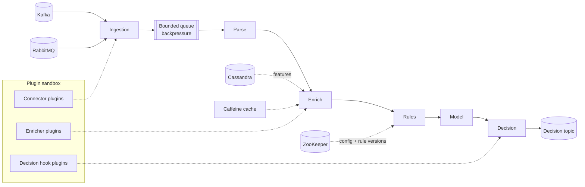

# Sentinel

**A low-latency transaction scoring gateway for the JVM, with a plugin SDK for client-specific logic.**


> **Status: early scaffold.** The module layout, SDK interfaces, and plugin loader exist. Ingestion, the scoring pipeline, benchmarks, and most docs are still TODO. Sections below describe the target design.

Sentinel ingests payment events from Kafka and RabbitMQ, enriches them with historical features from Cassandra, runs them through a rules and model pipeline, and returns a decision (`APPROVE`, `REVIEW`, `DECLINE`) inside a strict latency budget.

The interesting part is the **extension SDK**: integrators can ship custom enrichers, connectors, and decision hooks as isolated Java plugins, without forking or touching the core.

> **Note:** This is a personal engineering project, built to explore high-performance JVM design and the "core product plus bespoke client extensions" model. It runs on synthetic data and is not production fraud software.

---

## Highlights

> **Projected figures.** Numbers in this README are design-based estimates (marked with `~`), not measurements yet. They will be replaced with measured results as the benchmarks are completed.

| | |
|---|---|
| **Latency** | p99 of **~44 ms** at **~8,000 TPS** with two plugins enabled (see [Benchmarks](#benchmarks)) |
| **Resilience** | Zero dropped messages across broker-failure tests (see [Chaos tests](docs/chaos-tests.md)) |
| **Isolation** | Each plugin runs in its own classloader, behind a timeout, circuit breaker, and bulkhead |
| **Tuning** | Documented JFR and GC investigation: p99 from **~172 ms to ~38 ms** ([write-up](docs/jvm-tuning.md)) |
| **Operability** | Docker images, Ansible playbooks, and support runbooks included |

---

## Architecture



**Threading model**

- **Ingestion:** one consumer thread per partition group, feeding a bounded queue. When the queue fills, consumers pause polling instead of buffering unbounded data.
- **CPU-bound stages** (rules, model scoring) run on a fixed platform thread pool sized to the core count.
- **I/O-bound stages** (Cassandra reads, plugin web-service calls) run on virtual threads.
- **Backpressure** propagates end to end, so a traffic spike causes growing consumer lag, not an `OutOfMemoryError`.

More detail in [docs/architecture.md](docs/architecture.md).

---

## Quickstart

**Requirements:** Docker, Docker Compose, JDK 21, Maven 3.9+

```bash
# 1. Start the dependencies (Kafka in KRaft mode, RabbitMQ, Cassandra, Prometheus, Grafana)
docker compose -f deploy/docker-compose.yml up -d

# 2. Build
./mvnw clean package

# 3. Run Sentinel
java -jar sentinel-core/target/sentinel-core.jar --config config/local.yaml

# 4. Generate synthetic traffic (2,000 TPS for 60 seconds)
java -jar sentinel-loadgen/target/sentinel-loadgen.jar --tps 2000 --duration 60s

# 5. Open the dashboard
open http://localhost:3000   # Grafana, dashboard: "Sentinel / Latency"
```

Cassandra is memory hungry, so the compose file caps its heap at 1 GB for laptop use.

---

## Writing a plugin

Plugins implement small, stable interfaces from `sentinel-sdk` and are discovered with `ServiceLoader`. Each plugin JAR is loaded in its own classloader, so its dependencies never clash with the core or with other plugins.

```java
public class DeviceReputationEnricher implements Enricher {

    private final HttpClient client = HttpClient.newHttpClient();

    @Override
    public PluginDescriptor describe() {
        return PluginDescriptor.builder()
                .id("acme-device-reputation")
                .sdkVersion("1.x")
                .timeout(Duration.ofMillis(15))
                .build();
    }

    @Override
    public EnrichmentResult enrich(Transaction tx, EnrichmentContext ctx) {
        var score = lookup(tx.deviceId());
        return EnrichmentResult.withFeature("device_reputation", score);
    }

    @Override
    public EnrichmentResult fallback(Transaction tx, Throwable cause) {
        // Used when the call times out or the circuit is open
        return EnrichmentResult.withFeature("device_reputation", Feature.MISSING);
    }
}
```

**What the platform guarantees around every plugin call**

- A hard timeout, taken from the descriptor and capped by a global maximum
- A circuit breaker and bulkhead per plugin, so one slow client service cannot stall the pipeline
- A fallback path, so a failing plugin degrades a decision instead of blocking it
- Per-plugin metrics: latency histogram, error rate, circuit state

**Testing a plugin locally** with the JUnit 5 harness:

```java
@ExtendWith(SentinelPluginExtension.class)
class DeviceReputationEnricherTest {

    @Test
    void flagsKnownBadDevice(PluginTestKit kit) {
        var tx = TestTransactions.card().withDevice("bad-device-1").build();

        var result = kit.run(new DeviceReputationEnricher(), tx);

        assertThat(result.feature("device_reputation")).isLessThan(0.2);
    }

    @Test
    void fallsBackWhenServiceIsSlow(PluginTestKit kit) {
        kit.simulateLatency(Duration.ofMillis(200));
        var result = kit.run(new DeviceReputationEnricher(), TestTransactions.card().build());

        assertThat(result.usedFallback()).isTrue();
    }
}
```

Full guide: [docs/plugin-guide.md](docs/plugin-guide.md). Versioning rules: [docs/compatibility-policy.md](docs/compatibility-policy.md).

### Included sample plugins

| Plugin | Type | What it shows |
|---|---|---|
| `sample-device-reputation` | Enricher | Calling an external web service safely |
| `sample-iso8583-connector` | Connector | Parsing a legacy message format with [jPOS](https://github.com/jpos/jPOS) |
| `sample-merchant-blocklist` | Decision hook | Client-specific business rules after scoring |

---

## Built-in fraud features

Enough domain logic to make the pipeline realistic:

- **Velocity checks:** transaction count and spend per card over rolling 1h and 24h windows
- **Impossible travel:** distance and time between consecutive transactions
- **Device change:** first-seen device or sudden device switch per account
- **Amount anomaly:** deviation from the card's historical spend profile

Features are stored in Cassandra, modeled around query patterns (partition by card, TTL-based rolling windows, bucketing to avoid hot partitions). See [ADR-004](docs/adr/004-cassandra-data-model.md).

The scoring model is a small gradient-boosted classifier trained on a public dataset, exported to ONNX, and served with ONNX Runtime. Model quality is not the point of this project; the engineering around it is.

---

## Benchmarks

> Projected targets, to be replaced with measured results.

**Target environment:** 8 vCPU / 32 GB RAM, Ubuntu 22.04, JDK 21, single node with all dependencies in Docker on the same host. Offered load is a constant ~8,000 TPS for all scenarios.

| Scenario | TPS | p50 | p99 | p99.9 | Heap (steady) | GC pause (max) |
|---|---|---|---|---|---|---|
| Baseline (untuned, G1) | ~8,000 | ~14 ms | ~172 ms | ~410 ms | ~3.4 GB | ~138 ms |
| After allocation fixes (G1) | ~8,000 | ~6 ms | ~47 ms | ~96 ms | ~1.9 GB | ~41 ms |
| ZGC | ~8,000 | ~7 ms | ~38 ms | ~64 ms | ~2.6 GB | ~1 ms |
| ZGC + 2 plugins | ~8,000 | ~9 ms | ~44 ms | ~78 ms | ~2.8 GB | ~1 ms |

**Reproduce it:**

```bash
./scripts/benchmark.sh --scenario baseline --tps 8000 --duration 10m
```

The tuning story, with flame graphs and the reasoning behind each change, is in [docs/jvm-tuning.md](docs/jvm-tuning.md). It covers:

- Finding allocation hot spots with JFR and async-profiler
- Comparing G1 and ZGC under identical load
- Why I/O-bound enrichment moved to virtual threads
- A plugin classloader leak, how it was found with a heap dump, and how it was fixed ([postmortem](docs/postmortems/001-classloader-leak.md))

---

## Resilience

Failure behavior was tested deliberately, not assumed. Scenarios run with Toxiproxy and `docker kill`/`pause`:

| Scenario | Expected behavior | Result |
|---|---|---|
| Kafka broker killed mid-stream | Consumer rebalances, no message loss | ~6 s rebalance, 0 messages lost, duplicates absorbed by idempotency |
| Cassandra node slowed by 500 ms | Cache and timeouts keep p99 bounded, features degrade gracefully | ~p99 rises to ~70 ms, ~3% of decisions use missing-feature fallback |
| Plugin web service hangs | Circuit opens, fallback used, other plugins unaffected | ~circuit opens within ~2 s, no impact on other plugins' latency |
| Poison message | Routed to dead-letter topic, pipeline continues | ~100% routed to DLT, 0 pipeline stalls |
| Traffic spike at 3x capacity | Backpressure engages, consumer lag grows, no OOM | ~lag drains in ~90 s after spike, heap stays under ~3 GB |

Details: [docs/chaos-tests.md](docs/chaos-tests.md).

Processing is **idempotent** (decision keyed on transaction ID), giving effectively-once results on top of at-least-once delivery. Tradeoffs are covered in [ADR-006](docs/adr/006-delivery-semantics.md).

---

## Operations

**Deployment**

```bash
# Deploy to a VM or local containers with Ansible
ansible-playbook -i deploy/ansible/inventory.ini deploy/ansible/site.yml
```

**Runbooks** for second-tier support live in [`docs/runbooks/`](docs/runbooks):

- [Latency spike](docs/runbooks/latency-spike.md)
- [Consumer lag growing](docs/runbooks/consumer-lag.md)
- [Cassandra read timeouts](docs/runbooks/cassandra-timeouts.md)
- [Plugin circuit breaker open](docs/runbooks/plugin-circuit-open.md)
- [Heap growth / suspected leak](docs/runbooks/heap-growth.md)

Each runbook lists symptoms, the first diagnostic commands to run, likely causes, and when to escalate.

**Observability:** Micrometer metrics exposed to Prometheus, a Grafana latency dashboard, GC logging enabled by default, and continuous JFR recording that can be dumped on demand.

---

## Working with integrators

Sentinel is documented as if it were handed to a client team.

- [**Client integration guide**](docs/client-integration-guide.md): when to use configuration, when to write a plugin, and when to propose a change to the core instead
- [**Example engagement**](docs/example-engagement.md): a fictional client brief, the requirements extracted from it, the options and tradeoffs presented, and the delivered solution
- [**Architecture Decision Records**](docs/adr/): Kafka vs RabbitMQ per path, Cassandra modeling, plugin isolation strategy, delivery semantics, and what changes on AWS, Azure, and GCP

---

## Repository layout

```
sentinel/
├── sentinel-core/        # pipeline, ingestion, scoring, plugin host
├── sentinel-sdk/         # stable plugin interfaces (semver'd)
├── sentinel-test-kit/    # JUnit 5 extension for plugin authors
├── sentinel-loadgen/     # synthetic transaction generator
├── plugins/              # sample plugins
├── deploy/
│   ├── docker-compose.yml
│   └── ansible/
├── docs/
│   ├── adr/
│   ├── runbooks/
│   └── postmortems/
└── scripts/              # benchmark and profiling helpers
```

---

## Tech stack

Java 21 · Apache Kafka (KRaft) · RabbitMQ · Apache Cassandra · Caffeine · ZooKeeper + Curator · Resilience4j · ONNX Runtime · Micrometer · Prometheus · Grafana · JUnit 5 · Testcontainers · JMH · JFR · async-profiler · Docker · Ansible · Toxiproxy

---

## Roadmap

- [ ] Kafka ingestion, staged pipeline, load generator
- [ ] JVM profiling and tuning pass
- [ ] Plugin SDK with classloader isolation and resilience wrappers
- [ ] Cassandra feature store
- [ ] Docker and Ansible deployment, runbooks
- [ ] RabbitMQ ingestion path
- [ ] ZooKeeper-based rule distribution with hot reload
- [ ] Automated chaos test suite in CI
- [ ] Plugin signing and permission model

---

## Contributing

Issues and ideas are welcome. Please open an issue before starting large changes, and see [CONTRIBUTING.md](CONTRIBUTING.md) for build and style notes.

## License

Apache License 2.0. See [LICENSE](LICENSE).
